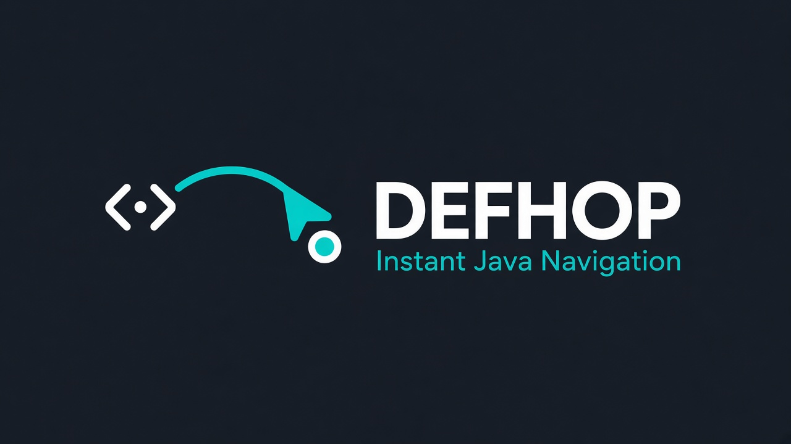

  

  <strong>Defhop</strong> · Java 代码导航助手 
  <em>跳转定义 · 查找引用 · 读代码更快</em>

  
  
  
  
  
  

  
  &nbsp;
  

---

# 中文

## 这是什么

**Defhop** 是专注 **代码导航** 的 Java 助手：

- **跳转定义**（`F12` / `Ctrl`+点击）
- **查找引用**
- 方法实现、继承关系
- Spring / MyBatis / Feign / Lombok / MapStruct 等跨文件跳转

适合大项目里 **看代码、追调用**——尤其是 AI 已经帮你写代码，你只想要一个又快又轻的「跳过去」工具。

引擎用 **Go** 编写：多核解析 Java，**不为导航再拉起 JVM**，体积小、内存省、跳转快。

> 不做补全、不做重构、不做 IDE 全家桶。装上就能导航。

Windows / Linux / macOS / WSL / Remote-SSH 均可使用。

## 请我喝杯咖啡

| 支付宝 | 微信 |
|:---:|:---:|
|  |  |

## 性能实测

本机 Windows（2026-10-27），多模块 Maven 工程，按规模列举：

| 规模 | 文件 / 模块 | 冷索引 | 跳转定义 | 工作集内存 |
|------|-------------|--------|----------|------------|
| 小型 | **~20** 个 `.java` | **~13 ms** | p95 **~1 ms** | **~14 MB** |
| 中型 | **~570** 个 `.java` · **~10** 个一级模块（约 **14** 个 Maven 模块） | **~0.3 s** | p95 **~2 ms** | **~70 MB** |
| 大型 | **~9,000** 个 `.java` · **~10** 个一级模块（约 **60** 个 Maven 模块）· ~10 万 symbols | **~9 s** | p95 **~1 ms** | **~830 MB** |

引擎体积约 **5.66 MB**。中型仓亚秒就绪，近万文件约数秒索引，跳转保持毫秒级；内存是导航引擎占用，不是再挂一整套 JVM Language Server。

## 支持能力

导航相关（转到定义 / 查找引用等）。框架能力**按需启用**，项目没用到的不占资源。

### Java

- 类 / 接口 / 枚举、方法 / 构造 / 字段 → 定义
- 继承与实现、方法重载、泛型（如 `Box<T>`）
- 查找引用、查找实现、同文件高亮（Document Highlight）
- Lambda 局部变量、方法引用（`Type::method`）
- Stream / Optional 链式跳转、包内跨文件类型
- JDK / 依赖源码（`src.zip`、`*-sources.jar`）；无源码时从 `.jar` / `.class` 跳转公开 API
- `record` 组件 / 访问器 / 方法体

### Spring

- `@Service` / `@Component` / `@RestController` 类型跳转
- 注入字段 / 构造注入 → 实现（支持 `@Qualifier` / 多实现优选）
- `@Value("${…}")` ↔ `application.yml` / `application-*.yml` / `.properties`（含嵌套占位符）
- `@ConfigurationProperties` 字段 ↔ 配置键（双向）

### Spring Cloud

- OpenFeign `@FeignClient` ↔ Controller（双向）
- 同路径 Controller 互跳；路径变量风格映射（如 `/items/{id}/…`）

### MyBatis / MyBatis-Plus

- Mapper 方法 ↔ XML `<select|insert|…>`（双向）
- 注解 Mapper（`@Select` / `@Insert` / …）→ Go to MyBatis SQL
- 业务代码中调用 Mapper 方法跳转
- `ServiceImpl` 中 `baseMapper` → 具体 Mapper / 自定义方法

### Lombok / MapStruct

- `@Data` / `@Getter` / `@Setter` / `@Builder` / `@SuperBuilder` 生成成员可导航
- `@NoArgsConstructor` / `@RequiredArgsConstructor` / `@AllArgsConstructor` 构造器可导航
- 方法引用中的 Lombok getter（如 `Customer::getName`）
- `@Mapper` 方法 → Impl；`@Mapping(target = "…")` → 字段

## 怎么用

1. 从扩展市场安装 **Defhop for Java**，重新加载窗口  
2. 打开 **Maven / Gradle** Java 项目  
3. 等待右下角索引完成  
4. 符号上 **`F12`** 或 **`Ctrl`+点击** 跳转定义，或右键 **查找引用**

命令面板搜 `Defhop`：

- **Refresh Index** — 刷新索引（保留缓存）  
- **Clear Cache and Rebuild** — 清缓存后全量重建  
- **Defhop JDK**（设置 / 状态栏）— 为本工作区指定 JDK，便于 `java.*` 跳转  
- **Go to MyBatis SQL** / **Go to Java Declaration** — Mapper ↔ XML  

仓库内 `testdata/samples` 覆盖上表能力的可跳转示例（含 Lombok 构造器、`@Select`、`@Qualifier`、多环境配置、同路径 Controller 等），说明见该目录 README。

## 反馈与许愿

新特性、跳转不准、找不到引用等，请到 GitHub [提 Issue](https://github.com/iCodZilla/defhop/issues)：

- **简单问题**：截图或几句话说明即可（在哪按了 `F12` / `Ctrl`+点击、期望去哪、实际怎样）。
- **复杂问题 / 新场景**：尽量给**最小可复现**——小示例项目或几段关键代码，并写清：
  - **从哪里**（文件 / 符号 / 光标位置）
  - **应该跳到哪里**（目标文件 / 方法 / 配置键 / XML id …）
  - **实际跳到了哪里**（或没有跳转）

越具体越好修；有「从 → 到」对照，优先处理。

## 和大型 Java 插件的区别

| | 传统 Java 套件 | Defhop |
|--|----------------|--------|
| 定位 | 补全 + 重构 + 调试 + … | **只做导航** |
| 引擎 | 常依赖 JVM Language Server | **Go 原生解析** |
| 体感 | 功能全，往往更重 | 轻、快 |
| AI 时代 | 与助手能力大量重叠 | **互补**：AI 写，Defhop 跳 |

---

# English

## What it is

**Defhop** is a **Java navigation helper**:

- Go to Definition (`F12` / `Ctrl`+click)
- Find References
- Implementations & inheritance
- Cross-file jumps for Spring / MyBatis / Feign / Lombok / MapStruct

Built for **reading code** in large repos—especially when AI already writes the code and you just need to hop around fast.

The engine is **Go**: multi-core Java parsing, **no JVM** just to navigate. Small binary, low RAM, fast hops.

> No completion. No refactoring. No full IDE suite. Install and navigate.

Works on Windows / Linux / macOS / WSL / Remote-SSH.

## Buy me a coffee

| Alipay | WeChat Pay |
|:---:|:---:|
|  |  |

## Benchmarks

Measured on Windows (2026-10-27), multi-module Maven workspaces by scale:

| Scale | Files / modules | Cold index | Go to Definition | Working set |
|-------|-----------------|------------|------------------|-------------|
| Small | **~20** `.java` | **~13 ms** | p95 **~1 ms** | **~14 MB** |
| Medium | **~570** `.java` · **~10** top-level modules (~**14** Maven modules) | **~0.3 s** | p95 **~2 ms** | **~70 MB** |
| Large | **~9,000** `.java` · **~10** top-level modules (~**60** Maven modules) · ~100k symbols | **~9 s** | p95 **~1 ms** | **~830 MB** |

Engine binary ≈ **5.66 MB**. Medium repos ready in under a second; ~10k-file workspaces index in a few seconds; jumps stay around **1–2 ms**. RAM is the nav engine—not a second JVM language server.

## Capabilities

Navigation only (Go to Definition / Find References, etc.). Framework support loads **on demand**.

### Java

- Class / interface / enum, method / ctor / field → definition
- Inheritance, overloads, generics (e.g. `Box<T>`)
- Find references, implementations, document highlight
- Locals in lambdas, method references (`Type::method`)
- Stream / Optional chains, cross-file types in the package
- JDK / dependency sources (`src.zip`, `*-sources.jar`); public API from `.jar` / `.class` when sources are missing
- `record` components / accessors / body methods

### Spring

- `@Service` / `@Component` / `@RestController` type jumps
- Injected field / ctor → implementation (honors `@Qualifier`)
- `@Value("${…}")` ↔ `application.yml` / `application-*.yml` / `.properties` (incl. nested placeholders)
- `@ConfigurationProperties` field ↔ config key (both ways)

### Spring Cloud

- OpenFeign `@FeignClient` ↔ Controller (both ways)
- Same-path Controller peers; path-variable style mappings

### MyBatis / MyBatis-Plus

- Mapper method ↔ XML `<select|insert|…>` (both ways)
- Annotation mappers (`@Select` / `@Insert` / …) via Go to MyBatis SQL
- Calls to Mapper methods in business code
- `baseMapper` in `ServiceImpl` → concrete Mapper / custom methods

### Lombok / MapStruct

- `@Data` / `@Getter` / `@Setter` / `@Builder` / `@SuperBuilder` generated members
- `@NoArgsConstructor` / `@RequiredArgsConstructor` / `@AllArgsConstructor`
- Lombok getters in method refs (e.g. `Customer::getName`)
- `@Mapper` method → Impl; `@Mapping(target = "…")` → field

## How to use

1. Install **Defhop for Java** and reload  
2. Open a **Maven / Gradle** Java workspace  
3. Wait for the status-bar index  
4. **`F12`** or **`Ctrl`+click** / Find References 

Command Palette → `Defhop`:

- **Refresh Index** — refresh (keep cache)  
- **Clear Cache and Rebuild** — full rebuild  
- **Defhop JDK** (settings / status bar) — set JDK for this workspace (`java.*` jumps)  
- **Go to MyBatis SQL** / **Go to Java Declaration** — Mapper ↔ XML  

See `testdata/samples` for jump fixtures covering the features above (Lombok ctors, `@Select`, `@Qualifier`, profile configs, path-peer Controllers, …).

## Feedback & requests

Feature ideas and navigation bugs: [GitHub Issues](https://github.com/iCodZilla/defhop/issues).

- **Simple**: a screenshot or a short note (where you used `F12` / `Ctrl`+click, what you expected, what happened).
- **Complex / new scenarios**: a **minimal repro**—small sample project or a few key snippets—and spell out:
  - **From** (file / symbol / cursor)
  - **Should jump to** (file / method / config key / XML id …)
  - **Actually jumped to** (or no jump)

Clear from → to cases get fixed first.

## vs full Java packs

| | Classic Java packs | Defhop |
|--|--------------------|--------|
| Role | Completion + refactor + debug + … | **Navigation only** |
| Engine | Often a JVM language server | **Go-native parser** |
| Feel | Complete, often heavy | Lean and fast |
| AI era | Overlaps assistants | **Complement**: AI writes, Defhop jumps |

---

   
  Defhop for Java · Java 导航 · 跳转定义 · 查找引用 
  <a href="https://github.com/iCodZilla/defhop/issues">GitHub 许愿 / Feature requests</a>

